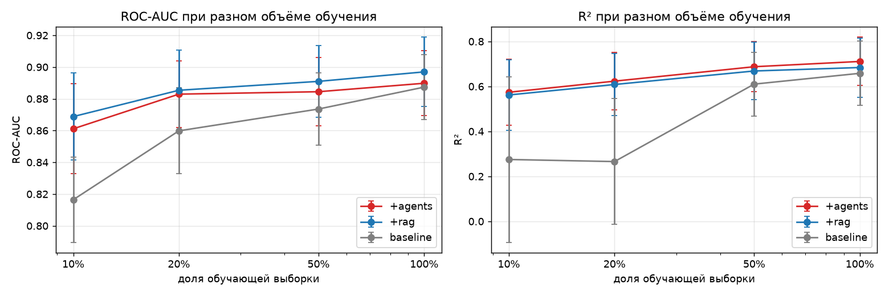

# Отчёт: прогноз успеваемости студентов мультиагентной системой (MLF-2026, №9)

## 1. Постановка

Две задачи по данным об активности и профиле студента:

- **классификация** риска неуспеваемости или отчисления (`G3 < 10`, `G3 < 12`, `dropout`, `final_score < 40`);
  основная метрика — ROC-AUC, дополнительно F1, Accuracy, Recall, Brier, ECE;
- **регрессия** итоговой оценки (`G3` 0–20, `final_score` 0–100); основная метрика — R², дополнительно MAE и RMSE.

## 2. Данные

| Источник | Строк | Признаков | Комментарий |
|---|---|---|---|
| UCI Student Performance (math 395 + portuguese 649) | 1 044 | 32 (+ цель G3) | реальные данные; в части наборов G1/G2 удалены — прогноз «на ранней стадии» |
| OULAD-подобный генератор | 200–4 000 | 20 (+0–15 шумовых) | демография, посещаемость, ДЗ, 3 теста, LMS-часы, форум, поздние сдачи; нелинейности, пропуски, дисбаланс |

В оценочных наборах было от 17 до 34 признаков, то есть всегда не меньше требуемых 5.

**База знаний** — 2 844 записи:
- 2 544 кейса студентов (1 044 UCI и 1 500 синтетических): профиль → итог и рекомендации;
- 300 кейсов выбора модели: для каждого набора (`split=kb`) прогонялась сетка из 6 конфигураций
  (LogReg/Ridge, RF, XGBoost) с 3-fold CV, лучшая сохранялась вместе с мета-признаками.
  Победители: LogReg 144, XGBoost 55, RF 54, Ridge 47.

**Справочник** — 510 терминов. Тестовые наборы (`split=eval`) сгенерированы с непересекающимися seed-ами.

Эмбеддинг кейса (128 измерений) склеивается из двух частей: 32 стандартизованных мета-признака набора или
канонического профиля студента и 96 измерений LSA-эмбеддинга (char n-gram TF-IDF + SVD) от
контекстуализированного описания (Contextual Retrieval). Поиск гибридный: BM25 и косинусный поиск,
объединённые через RRF (k = 60), с фильтром по `problem_type` и `kind`.

## 3. Методика оценки

В `scripts/run_eval.py` для каждого набора выделяется тестовая выборка (holdout), которая имитирует новых студентов.
Для классификации сохраняются пропорции классов, насколько позволяет группировка по ученикам. Модель обучается на
10 / 20 / 50 / 100 % оставшихся данных. В табличной теме размер holdout 10 / 20 / 50 % задаёт долю студентов для проверки.

В объединённом UCI часть учеников записана дважды, по одному разу на предмет. При случайном разбиении строк на одном
контрольном прогоне в обучении и тесте совпали 118 групп профилей. Теперь профили группируются перед разбиением и
кросс-валидацией. В контроле для `uci_both` и цели `G3 < 10` пересечений стало 0. Логистическая регрессия на новом тесте
дала ROC-AUC 0,9603 с промежуточными оценками G1/G2 и 0,7973 без них. Это сравнение с одним разбиением показывает,
как сильно для раннего прогноза влияет доступность промежуточных оценок.

Эксперименты с RAG используют отдельный индекс из 179 синтетических кейсов выбора модели. У них независимые seed и
отсутствуют профили UCI, на которых идёт оценка. В демонстрационном приложении используется полная база знаний.

| Режим | Что делает |
|---|---|
| `baseline` | логистическая регрессия (balanced) / Ridge с параметрами по умолчанию, без LLM и RAG |
| `+rag` | гибридный поиск 5 похожих кейсов, голосование их лучших моделей (вес 1/rank) и гиперпараметры лучшего кейса |
| `+agents` | полный цикл Supervisor (DataAnalyst → ModelSelector[Tool Calling + RAG] → Validator → Critic → Editor, до 3 итераций); HITL автоматически разрешается как `accept` и учитывается в метриках |

Режим `+foundation` (TabPFN) поддержан в коде, но в этом прогоне не запускался: пакет не установлен.
В сравнении `+agents` использует `mock` — детерминированные правила, которые воспроизводят один и тот же выбор
инструментов. Интеграцию с настоящей LLM проверяет отдельный прогон с Qwen.

Для сравнения по наборам использованы парный тест Уилкоксона, парный t-тест и 95-процентные интервалы по бутстрэпу.
Скрипт также выводит тест Диболда–Мариано по квадратичным потерям (Brier для классификации) внутри набора. В табличных
данных порядок студентов произвольный, поэтому выводы отчёта опираются на парные сравнения по наборам.

Прогоны:
1. **Объём данных:** 20 наборов (14 классификация, 6 регрессия) × 4 доли × 3 режима, holdout 20 %.
   [240 запусков завершились без ошибок](reports/eval_fractions.md).
2. **Размер отложенной выборки:** 20 наборов (14 классификация, 6 регрессия), holdout 10 / 20 / 50 %,
   режимы `baseline` и `+rag`. [120 запусков завершились без ошибок](reports/eval_horizons.md).
3. **Число наборов:** первые 20, 50 и 100 наборов общей подборки из 200 спецификаций. Для каждого набора прошли три
   режима с holdout 20 % и всеми оставшимися данными для обучения. Всего 510 успешных запусков, 0 ошибок. Наборы
   в меньших прогонах входят в большие, а варианты UCI используют общий исходный датасет.

## 4. Результаты

### 4.1 Качество в зависимости от объёма данных



Точки — средние показатели по наборам, вертикальные отрезки — стандартные ошибки этих средних.

| Классификация, ROC-AUC | 10 % | 20 % | 50 % | 100 % |
|---|---|---|---|---|
| `baseline` | 0,8164 | 0,8598 | 0,8736 | 0,8874 |
| `+rag` | **0,8688** | **0,8854** | **0,8910** | **0,8970** |
| `+agents` | 0,8611 | 0,8829 | 0,8845 | 0,8898 |

| Регрессия, R² | 10 % | 20 % | 50 % | 100 % |
|---|---|---|---|---|
| `baseline` | 0,2751 | 0,2657 | 0,6102 | 0,6583 |
| `+rag` | 0,5620 | 0,6085 | 0,6686 | 0,6841 |
| `+agents` | **0,5740** | **0,6234** | **0,6876** | **0,7111** |

- В классификации преимущество `+rag` над `baseline` уменьшалось с ростом обучающей выборки. Прирост ROC-AUC
  составил 0,0524 при 10 % и 0,0096 при 100 %. По тесту Уилкоксона `p < 0,05` при 10, 20 и 50 % данных.
- В регрессии наибольший средний R² показал `+agents`. Результаты при 10 и 20 % обучения чувствительны к выбору
  наборов. Например, для прироста R² у `+rag` при 10 % доверительный интервал широкий, от 0,0378 до 0,7395.
  В этом эксперименте было шесть наборов регрессии.
- F1 и Recall при пакетном сравнении рассчитаны при общем пороге 0,5. В рабочем режиме Editor может подобрать
  другой порог по кросс-валидации. ROC-AUC оценивает ранжирование студентов по риску без фиксированного порога.

### 4.2 Размер отложенной выборки


| Доля студентов в тесте | Прирост ROC-AUC у `+rag` | 95 % ДИ | Прирост R² у `+rag` | 95 % ДИ |
|---|---:|---|---:|---|
| 10 % | +0,0228 | [0,0107; 0,0349] | +0,0211 | [−0,0040; 0,0478] |
| 20 % | +0,0096 | [0,0019; 0,0177] | +0,0258 | [0,0034; 0,0502] |
| 50 % | +0,0181 | [0,0067; 0,0300] | +0,0688 | [0,0129; 0,1343] |

На графике точка показывает средний прирост над `baseline`, отрезок — 95-процентный доверительный интервал по бутстрэпу.
По тесту Уилкоксона различие ROC-AUC заметно при 10 % (`p = 0,0063`) и 50 % (`p = 0,0166`), а при 20 % значение
`p = 0,0676`. Для R² при шести наборах регрессии все значения `p` выше 0,05. Показатели сравниваются внутри каждой пары
на одном отложенном наборе.

### 4.3 Стоимость и агентные метрики


Графики объединяют четыре доли обучения на 20 наборах. В таблице ниже приведён отдельный прогон на 100 наборах
с полной обучающей выборкой.

| Метрика (100 запусков `+agents` на holdout 20 %) | Значение |
|---|---|
| Среднее число итераций Supervisor | 1,26 |
| Доля задач, потребовавших HITL | 10 % |
| Время на задачу | 8,69 с |
| Вызовов `mock` на задачу | 2,52 |
| Приблизительное число токенов промптов и ответов на задачу | 2 923 |
| Способ выбора модели | 84 вызова инструмента, 16 сохранений модели после правок Editor |
| Выбранные модели | логистическая регрессия 64, Ridge 19, Random Forest 10, XGBoost 7 |

`+rag` на этих 100 наборах занимал в среднем 0,14 с. Агентный режим тратит время на кросс-валидацию, оценку важности
признаков, проверку качества и возможное повторное обучение. Время живой LLM измерено отдельно ниже.

### 4.4 Проверка реальной LLM на ноутбуке

Режим `+agents` с `ollama:qwen2.5:1.5b` прошёл 6 из 6 наборов при лимите в одну итерацию и отключённом резервном
провайдере. `ollama ps` показала 100 % GPU на RTX 3050. Среднее время после прогрева — 32,08 с на набор. В одном
запуске Qwen вернула нативный вызов инструмента, в остальных пяти сработал разбор текстового ответа. На пяти наборах
классификации средний ROC-AUC составил 0,9434, на одном наборе регрессии R² составил 0,8779. В трёх запусках система
попросила ручную проверку, а скрипт эксперимента автоматически принял текущий результат. Эти шесть запусков проверяют
интеграцию с Ollama. В сравнении качества режимов использовался `mock` со своим отдельным набором результатов.

Запасной локальный провайдер Hugging Face Transformers проверили отдельным текстовым запросом к
`Qwen/Qwen2.5-0.5B-Instruct`. Модель ответила на CPU в изолированном контейнере с уже скачанными весами и
без доступа к сети. Внешние API в этих проверках не запускались.

### 4.5 Проверка запуска и демонстрации

На Windows прошли 86 тестов с покрытием серверного кода 93,04 %. Локально и в Docker проверили вход в Gradio, API
прогноза риска и итоговой оценки на `uci_mat`, журнал действий агентов, скачивание CSV, очередь проверок и фоновую
оценку на двух наборах. Сервис `init` импортировал 2 844 записи и 510 терминов в Docker, поиск по векторному индексу
вернул результаты, хотя клиент Qdrant предупредил о разнице версий с сервером. Docker для этой проверки использовал `mock`.

### 4.6 Сравнение режимов на 20, 50 и 100 наборах

| Наборов | Режим | ROC-AUC, среднее | R², среднее |
|---:|---|---:|---:|
| 20 | `baseline` | 0,8874 | 0,6583 |
| 20 | `+rag` | **0,8970** | 0,6841 |
| 20 | `+agents` | 0,8898 | **0,7111** |
| 50 | `baseline` | 0,8713 | 0,6613 |
| 50 | `+rag` | **0,8861** | 0,6799 |
| 50 | `+agents` | 0,8825 | **0,7030** |
| 100 | `baseline` | 0,8663 | 0,6625 |
| 100 | `+rag` | **0,8800** | 0,6794 |
| 100 | `+agents` | 0,8796 | **0,6961** |

Во всех трёх прогонах `+rag` показал наибольший средний ROC-AUC, а `+agents` — наибольший средний R². На 100 наборах
разница ROC-AUC между `+rag` и `+agents` составила 0,0004, а 95-процентный доверительный интервал разности включает 0.
Прирост R² у `+agents` относительно `baseline` составил 0,0336 (95 % ДИ [0,0129; 0,0613]). На двух наборах в тесте
оказалось меньше 10 студентов редкого класса, поэтому их ROC-AUC следует читать с осторожностью.

## 5. Ограничения и что улучшить

- `+agents` сравнивался с другими режимами на детерминированном `mock`. Для сравнения качества с реальной LLM
  нужен отдельный эксперимент с такой же выборкой и условиями для каждого режима.
- Редактор не должен ухудшать результат: стоит принимать правку только при улучшении OOF-метрики
  (accept-if-better).
- Агрегаты активности в feature engineering нормируются по всей выборке. Это не утечка цели, но
  трансдуктивная статистика; в продакшене её нужно подгонять на train.
- TabPFN (`+foundation`) и эмбеддинги sentence-transformers поддержаны опционально и в отчётный прогон не входили.
- Синтетические данные доминируют в наборах (57 % строк оценки). Реальные OULAD/Kaggle подключаются
  через `scripts/download_data.py --kaggle`.

## 6. Воспроизведение

```powershell
$env:MLF_LLM_PROVIDER = 'mock'
foreach ($datasetCount in 20, 50, 100) {
    .venv\Scripts\python.exe scripts/run_eval.py --num-series $datasetCount --holdouts 0.2 --modes baseline +rag +agents --no-db
}
```

```powershell
.venv\Scripts\python.exe scripts/run_eval.py --num-series 20 --modes baseline +rag +agents --data-fractions 0.1 0.2 0.5 1.0 --holdouts 0.2 --no-db
```
```powershell
.venv\Scripts\python.exe scripts/run_eval.py --num-series 20 --modes baseline +rag --horizons 10 20 50 --no-db
```
```powershell
.venv\Scripts\python.exe scripts/make_report_plots.py 'results/папка_прогона'
```
