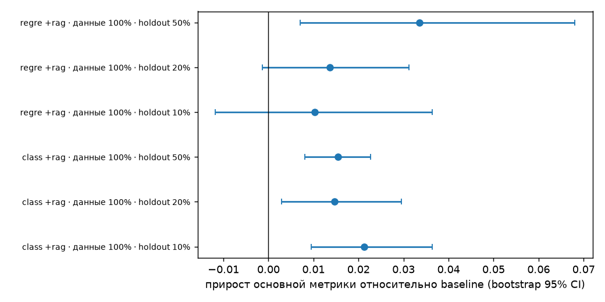
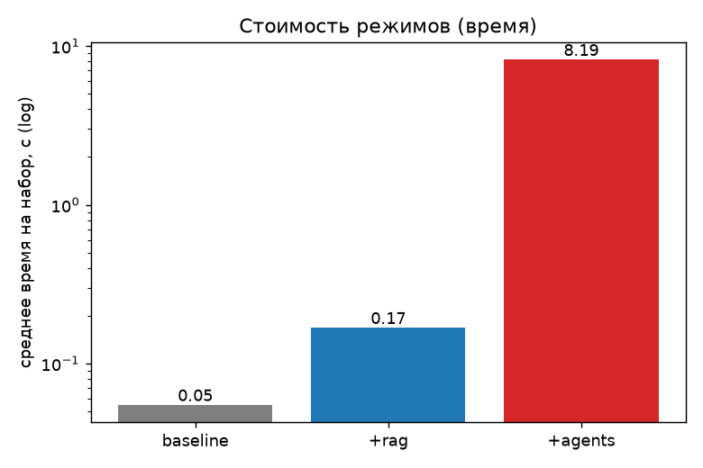
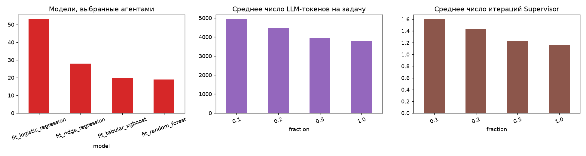

# Отчёт: прогноз успеваемости студентов мультиагентной системой (MLF-2026, №9)

## 1. Постановка

Две задачи по данным об активности и профиле студента:

- **классификация** риска неуспеваемости или отчисления (`G3 < 10`, `G3 < 12`, `dropout`, `final_score < 40`);
  основная метрика — ROC-AUC, дополнительно F1, Accuracy, Recall, Brier, ECE;
- **регрессия** итоговой оценки (`G3` 0–20, `final_score` 0–100); основная метрика — R², дополнительно MAE и RMSE.

## 2. Данные

| Источник | Строк | Признаков | Комментарий |
|---|---|---|---|
| UCI Student Performance (math 395 + portuguese 649) | 1 044 | 32 (+ цель G3) | реальные данные; в части наборов G1/G2 удалены — прогноз «на ранней стадии» |
| OULAD-подобный генератор | 200–4 000 | 20 (+0–15 шумовых) | демография, посещаемость, ДЗ, 3 теста, LMS-часы, форум, поздние сдачи; нелинейности, пропуски, дисбаланс |

В оценочных наборах было от 17 до 34 признаков, то есть всегда не меньше требуемых 5.

**База знаний** — 2 844 записи:
- 2 544 кейса студентов (1 044 UCI и 1 500 синтетических): профиль → итог и рекомендации;
- 300 кейсов выбора модели: для каждого набора (`split=kb`) прогонялась сетка из 6 конфигураций
  (LogReg/Ridge, RF, XGBoost) с 3-fold CV, лучшая сохранялась вместе с мета-признаками.
  Победители: LogReg 144, XGBoost 55, RF 54, Ridge 47.

**Справочник** — 510 терминов. Тестовые наборы (`split=eval`) сгенерированы с непересекающимися seed-ами.

Эмбеддинг кейса (128 измерений) склеивается из двух частей: 32 стандартизованных мета-признака набора или
канонического профиля студента и 96 измерений LSA-эмбеддинга (char n-gram TF-IDF + SVD) от
контекстуализированного описания (Contextual Retrieval). Поиск гибридный: BM25 и косинусный поиск,
объединённые через RRF (k = 60), с фильтром по `problem_type` и `kind`.

## 3. Методика оценки

`scripts/run_eval.py`. Для каждого набора выделяется стратифицированный holdout «новых студентов».
Обучение идёт на стратифицированной подвыборке 10 / 20 / 50 / 100 % оставшихся данных.

| Режим | Что делает |
|---|---|
| `baseline` | логистическая регрессия (balanced) / Ridge с параметрами по умолчанию, без LLM и RAG |
| `+rag` | гибридный поиск 5 похожих кейсов, голосование их лучших моделей (вес 1/rank) и гиперпараметры лучшего кейса |
| `+agents` | полный цикл Supervisor (DataAnalyst → ModelSelector[Tool Calling + RAG] → Validator → Critic → Editor, до 3 итераций); HITL автоматически разрешается как `accept` и учитывается в метриках |

Режим `+foundation` (TabPFN) поддержан в коде, но в этом прогоне не запускался: пакет не установлен.
В `+agents` использовался детерминированный `mock`-провайдер LLM. Это воспроизводимая политика,
эквивалентная «разумной» модели, а не Qwen.

Статистика: парные Wilcoxon и t-test по наборам; bootstrap 95% CI среднего прироста; тест Диболда–Мариано
(с поправкой HLN) на поэлементных квадратичных потерях (Brier для классификации) отдельно по каждому набору.

Прогоны:
1. **Объём данных:** 30 наборов (21 классификация, 9 регрессия) × 4 доли × 3 режима, holdout 20 % —
   [reports/eval_fractions.md](reports/eval_fractions.md).
2. **«Горизонты»:** 50 наборов (33 + 17), holdout 10 / 20 / 50 %, режимы baseline и +rag —
   [reports/eval_horizons.md](reports/eval_horizons.md).

## 4. Результаты

### 4.1 Качество в зависимости от объёма данных


| Классификация, ROC-AUC | 10 % | 20 % | 50 % | 100 % |
|---|---|---|---|---|
| baseline | 0.811 | 0.832 | 0.861 | 0.882 |
| +rag | **0.845** | **0.865** | **0.885** | **0.893** |
| +agents | 0.830 | 0.858 | 0.877 | 0.888 |

| Регрессия, R² | 10 % | 20 % | 50 % | 100 % |
|---|---|---|---|---|
| baseline | 0.485 | 0.523 | 0.660 | 0.728 |
| +rag | 0.582 | 0.612 | 0.725 | 0.747 |
| +agents | 0.580 | 0.613 | **0.727** | **0.749** |

Выводы:
- Выбор модели по похожим кейсам (RAG) **значимо** лучше фиксированного baseline. Для классификации
  Wilcoxon p ≤ 0.002 на всех долях, win rate 81–90 %, bootstrap CI прироста при 20 % и 50 % данных
  не содержит нуля (+0.033 и +0.024 ROC-AUC). Для регрессии прирост R² +0.09…0.10 при 10–20 % данных
  (Wilcoxon p = 0.016).
- **Выигрыш от RAG максимален на малых данных и уменьшается с ростом выборки**: +0.034 → +0.012 ROC-AUC
  и +0.097 → +0.019 R². При 100 % данных baseline почти догоняет, а для регрессии разница уже незначима
  (p = 0.22). На малых выборках важнее правильно выбрать класс модели и регуляризацию. На больших
  логистическая регрессия на признаках с G1/G2 и так близка к потолку.
- Кривые насыщаются примерно к 50 % данных (≈ 250–1 500 студентов).
- `+agents` значимо лучше baseline по ROC-AUC (Wilcoxon p = 0.013–0.042), но **не лучше `+rag`**
  (Δ от −0.005 до −0.015, незначимо, p ≥ 0.45). Mock-LLM выбирает модель по тем же RAG-кейсам, поэтому
  стартовая точка у режимов общая. Дальше Editor при низкой оценке Critic добавляет признаки
  (динамика оценок, агрегаты активности) и меняет порог. На ROC-AUC это почти не влияет, а на малых
  выборках новые признаки слегка добавляют дисперсии. Агентный цикл в этой реализации оптимизирует
  **интерпретируемость, порог группы риска и надёжность** (утечки, калибровка, HITL), а не ROC-AUC.
- F1 и Recall в таблицах посчитаны при фиксированном пороге 0.5. Порог, подобранный агентом
  (максимум F1 по OOF), в эту оценку не входит, поэтому F1 для `+agents` занижен относительно его
  рабочего режима.

### 4.2 Размер отложенной выборки («горизонт»)



При holdout 10 / 20 / 50 % прирост `+rag` над baseline по ROC-AUC составляет +0.021 / +0.015 / +0.015;
во всех случаях CI > 0, Wilcoxon p ≤ 0.0013, win rate до 97 %. Тест Диболда–Мариано показывает значимое
различие на 5–10 из 33 наборов, и почти всегда в пользу +rag (9 из 10 при holdout 50 %). Чем больше
тестовая выборка, тем мощнее DM-тест. Для регрессии прирост R² значим при holdout 50 %
(+0.034, CI [0.007; 0.068]).

### 4.3 Стоимость и агентные метрики




| Метрика (120 запусков `+agents`) | Значение |
|---|---|
| Среднее число итераций Supervisor | 1.36 (1.6 при 10 % данных → 1.17 при 100 %) |
| Доля задач, потребовавших HITL | 14.2 % (20 % на малых выборках → 6.7 % на полных) |
| Время на задачу | 8.2 с (baseline 0.05 с, +rag 0.2 с) |
| LLM-вызовов на задачу | 2.7 |
| Токенов на задачу | ≈ 4 300 (≈ 4 900 при 10 % данных) |
| Способ выбора модели | native tool call 96, сохранение модели после правок Editor 23, принудительно 1; fallback по умолчанию не понадобился |
| Выбранные модели | LogReg 53, Ridge 28, XGBoost 20, RF 19 |

Агентный режим примерно в 40 раз дороже `+rag` по времени (обучение на каждой итерации, permutation importance,
объяснения). LLM добавляет около 4 тыс. токенов на задачу. Для Qwen2.5-7B на RTX 4060 это ещё
~5–15 с инференса. Чем меньше данных, тем чаще цикл не сходится и уходит к человеку: на малых выборках
Validator и Critic честно сигнализируют о ненадёжности модели.

### 4.4 Пример работы на UCI (G3 < 10, все 1 044 студента)

ModelSelector через tool call выбрал логистическую регрессию (ElasticNet, C = 0.1): именно она победила
на похожих кейсах из RAG. Результат: ROC-AUC CV 0.971 / holdout 0.969, recall 0.92, ECE 0.088.
Critic поставил 9.75/10. Validator выдал предупреждение `dominant_feature`: G2 даёт основную долю важности,
что ожидаемо, так как это оценка за второй период. Цикл сошёлся за 1 итерацию, 187 студентов отнесены
к высокому риску и поставлены в очередь преподавателя. Без G1/G2 (ранний прогноз) ROC-AUC падает
примерно до 0.77. Тогда Editor добавляет признаки динамики и активности и снижает порог до 0.13
по максимуму F1, а задача уходит в HITL.

## 5. Ограничения и что улучшить

- Оценка `+agents` проведена с mock-LLM. С Ollama (`MLF_LLM_PROVIDER=ollama`, `qwen2.5:7b`) поведение
  ModelSelector, Critic и Editor станет недетерминированным. Сравнение с реальной LLM — следующий шаг:
  `scripts/run_eval.py` запускается без изменений.
- Редактор не должен ухудшать результат: стоит принимать правку только при улучшении OOF-метрики
  (accept-if-better).
- Агрегаты активности в feature engineering нормируются по всей выборке. Это не утечка цели, но
  трансдуктивная статистика; в продакшене её нужно подгонять на train.
- TabPFN (`+foundation`) и эмбеддинги sentence-transformers поддержаны опционально и в отчётный прогон не входили.
- Синтетические данные доминируют в наборах (57 % строк оценки). Реальные OULAD/Kaggle подключаются
  через `scripts/download_data.py --kaggle`.

## 6. Воспроизведение

```bash
.venv\Scripts\python scripts/run_eval.py --num-series 30 --modes baseline +rag +agents --data-fractions 0.1 0.2 0.5 1.0 --horizons 20
```
```bash
.venv\Scripts\python scripts/run_eval.py --num-series 50 --modes baseline +rag --horizons 10 20 50
```
```bash
.venv\Scripts\python scripts/make_report_plots.py results/<папка_прогона>
```
